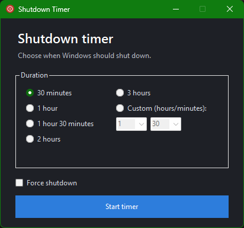

# Shutdown Timer

A lightweight and standalone Windows desktop app with a GUI that lets you easily schedule a timed system shutdown.

## Features

- Choose from preset shutdown durations or define a custom timer.
- Cancel a scheduled shutdown at any time.
- Minimize the app to the system tray while the timer is active.
- Optionally force shutdown, which passes the `/f` flag to `shutdown.exe` so Windows will terminate applications that are preventing shutdown.

## How it works

The app uses the built-in Windows `shutdown.exe` command with a delay of zero seconds when the countdown reaches its end. If the `Force shutdown` option is enabled, it adds the `/f` flag so the system will force close running applications.

## Requirements

- Windows
- .NET Framework 4.8

## Running the app

1. Download the latest release from the GitHub Releases page. (Or build the project from source.)
2. Run `ShutdownTimer.exe`.
3. Choose a timer duration and click `Start timer`.
